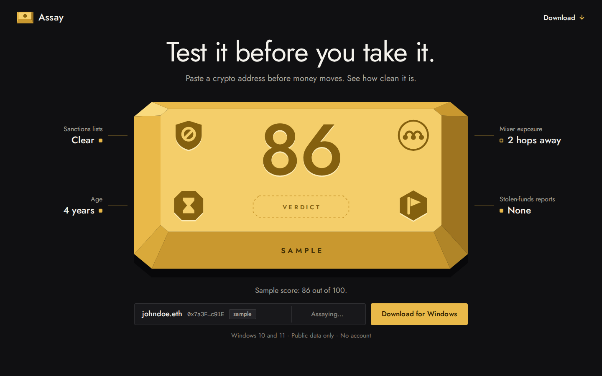
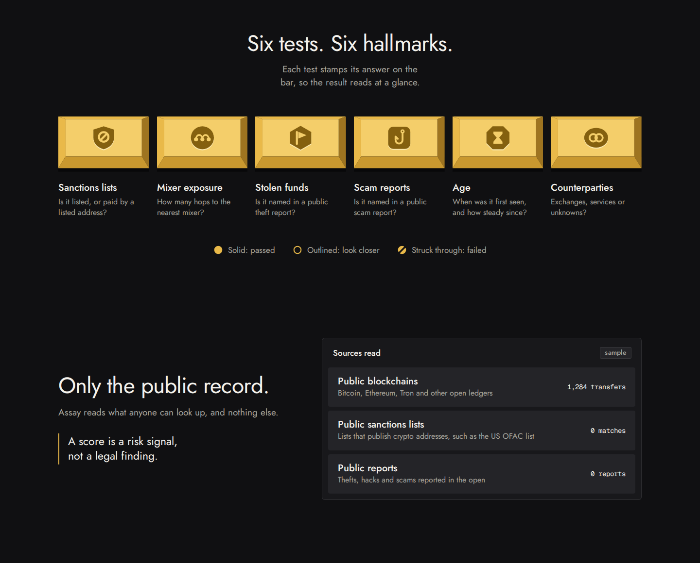
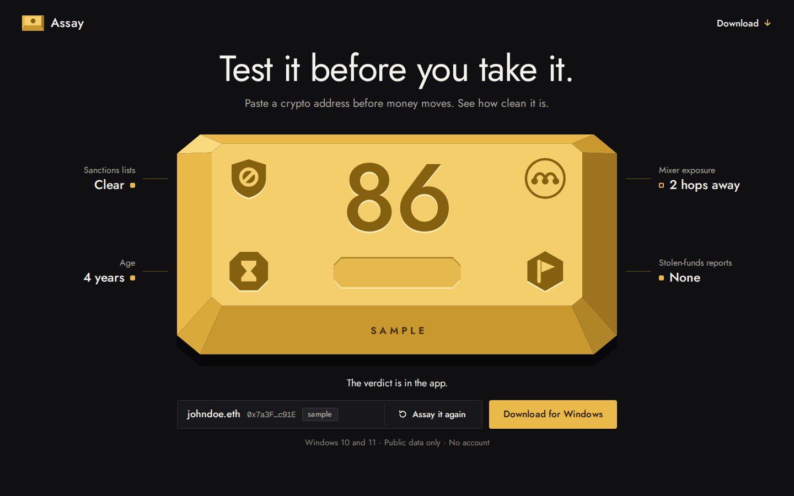

<h1 align="center">Assay: OSINT crypto address reputation and AML check</h1>

<b>Test it before you take it.</b> Paste a crypto address before money moves. See how clean it is.

OSINT · OSINT tool · crypto address check · AML check · wallet reputation · blockchain analysis · sanctions screening · windows

> **Status: v2.4.1.** The app is out — [download Assay for Windows](https://awesomeosint.tools/assay/).

## Why this exists

A wire lands, the address has no name on it, and the clock is ticking. The answer about that address is public — it just lives in six different places.

## Why it is different

Explorers show transactions. Risk vendors show scores behind a login. Assay reads the same public signals, explains each one, and adds them into a single number you can act on.

## The idea

- **One object.** A gold bar. An assay office tests metal and stamps the result into it.
- **One number.** The score punched into the top face, 0 to 100.
- **Colour.** Graphite `#101012` and white. Gold `#E9B949` is the bar, the marks and the download, nothing else. The bar is drawn in flat facets: four golds (`#F4CE6A`, `#E9B949`, `#C9982F`, `#9E7420`) and three in-between tones on the small corner facets. No gradients.
- **The main feature.** The hallmarks. Every test an address passes or fails is stamped onto the bar, so the result reads at a glance and can be shown to someone else. Solid means passed, outlined means look closer, struck through means failed.

## The demo on the page

The bar is assayed by itself. Four hallmarks are struck one by one (the bar dips at each strike) and what each one says appears beside the bar: Sanctions lists: clear, Mixer exposure: 2 hops away, Age: 4 years, Stolen-funds reports: none. Then the score counts up to 86 and is punched into the top face. The last and largest hallmark, the verdict, is struck blank: an empty recess, the line "The verdict is in the app", the download button and "Assay it again".

The run waits while the bar is off screen or the tab is hidden, and with reduced motion the page opens on the finished bar. The address field is not an input: nothing a visitor types is read.

